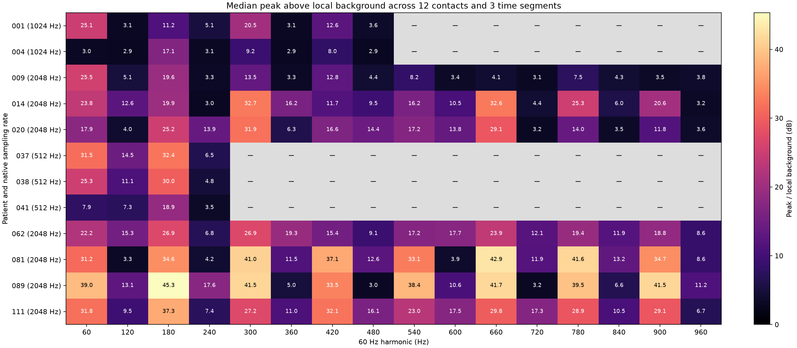
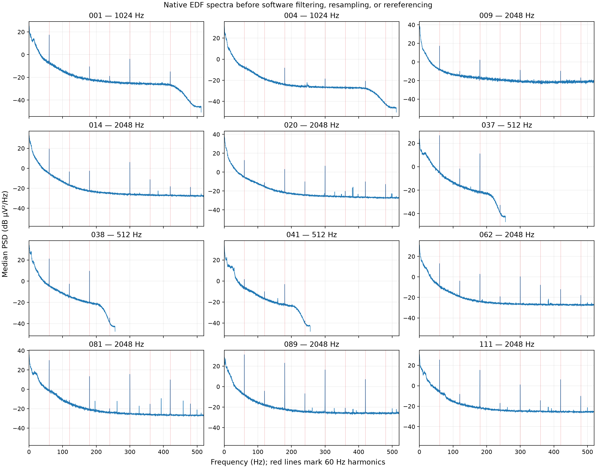

# EEG line-noise inspection

Exploratory read-only inspection, 2026-10-14. This informs preparation settings; it does not change calculations, workflow execution, EDFs, or existing patient stores.

## Findings and proposed policy

- The sample contains 12 patients and 144 included contacts, with three 60-second sections per patient. Seven patients have native 2048 Hz data, two 1024 Hz, and three 512 Hz. Contacts were selected from the existing Zarr calculation electrode lists, preserving the authoritative inclusion decisions.
- Strong narrow peaks occur at 60, 180, 300, and 420 Hz across all seven sampled 2048 Hz patients. Even harmonics vary by patient and contact; their absence from some spectra does not justify omitting them from a common preparation configuration.
- Additional harmonics are present above 500 Hz. A configured low-pass passband edge is not an abrupt frequency cutoff: an illustrative MNE 0.5–500 Hz FIR design at 2048 Hz with automatic transitions attenuates 540 Hz by only about 2 dB and reaches its upper stopband at 625 Hz.
- Subsequently agreed for implementation: generate every 60 Hz harmonic whose entire notch and transition fit below Nyquist at the filtering stage, with an initial 1 Hz full stopband width. For a 2048 Hz signal this includes 60, 120, …, 960 Hz. Higher notches are largely redundant once low-pass filtering has sufficiently attenuated those frequencies, but this simple rule covers the transition band and accommodates changes to the upper edge. Never include a notch at Nyquist itself; validate its width and transition margins too. The base line frequency and notch settings remain configurable.
- A 1 Hz full notch stopband width with MNE FIR filtering is a supported initial candidate. The seven-patient temporary-array comparison suppressed all 703 initially strong central peaks below the local background, with minimum measured suppression about 51.7 dB and median about 54.8 dB. No initially strong observation retained a peak of 10 dB or more within the wider ±2 Hz search. The 2 Hz alternative suppressed more strongly, but the sample did not demonstrate a need for the additional removed bandwidth.
- Notching removes neural signal as well as interference within the affected bands. This inspection establishes spectral suppression on the sampled clips, not mathematical correctness of every connectivity estimator or validation of the final preparation chain.

## Sampling and measurements

Twelve evenly spaced positions were selected from each existing `patient_info/electrode` array. Contacts were mapped uniquely to EDF labels using the data lake’s whitespace/prime normalization and EEG-prefix removal. Existing Zarrs were opened in read-only mode. EDF samples were read with MNE, with no resampling, added referencing, or additional filtering for the initial survey. Acquisition filtering is not established by this analysis.

Each recording contributed three nonoverlapping 60-second sections: starting 20 seconds after the recording began, centered in the recording, and ending 20 seconds before the recording ended. Welch spectra used 8-second Hann windows, 4-second overlap, constant detrending inside those Welch windows, density scaling, and median averaging. Frequency spacing was 0.125 Hz. This spectral-estimation detrending is not a change to the agreed calculation preprocessing.

For each harmonic, the maximum within ±2 Hz was compared with the median power in the flanks 3–6 Hz away. “Strong” means at least 10 dB above that background. This is an exploratory screening heuristic, not a calibrated significance test. Contact/time measurements are repeated observations, not independent patients. Half-power widths are affected by Welch resolution and frequency/amplitude variation; they are not exact physical linewidth estimates.

### Native 2048 Hz subset

Each harmonic has 252 observations: seven patients × twelve contacts × three time sections. Lower-rate patients are excluded from this table so their unavailable higher bands do not distort the comparison.

| Harmonic (Hz) | Median peak above background (dB) | Strong observations | Patients with at least one strong observation |
|---:|---:|---:|---:|
| 60 | 25.9 | 249/252 | 7/7 |
| 120 | 9.6 | 120/252 | 5/7 |
| 180 | 27.5 | 250/252 | 7/7 |
| 240 | 6.5 | 76/252 | 3/7 |
| 300 | 31.9 | 247/252 | 7/7 |
| 360 | 10.4 | 133/252 | 5/7 |
| 420 | 18.6 | 226/252 | 7/7 |
| 480 | 10.2 | 133/252 | 6/7 |
| 540 | 18.9 | 221/252 | 7/7 |
| 600 | 11.2 | 153/252 | 6/7 |
| 660 | 30.1 | 221/252 | 7/7 |
| 720 | 5.0 | 101/252 | 3/7 |
| 780 | 25.3 | 219/252 | 7/7 |
| 840 | 7.2 | 91/252 | 4/7 |
| 900 | 21.1 | 209/252 | 7/7 |
| 960 | 6.2 | 49/252 | 4/7 |

Gray cells are unavailable because they exceed native Nyquist; they do not indicate an absence of line noise in measured data.

## Candidate notch comparison

Patients 001, 009, 014, 020, 037, 089, and 111 contributed their middle 60-second sections. All native-rate 60 Hz harmonics through 960 Hz were included where available. Filters were applied only to temporary arrays, independently of the eventual resampling/bandpass order. Ten seconds were trimmed from each end before comparing spectra, to focus on the interiors rather than the artificial boundaries of the extracted clips.

The candidates used `mne.filter.notch_filter`: FIR, zero phase, Hamming window, `firwin` design, automatic filter length, and `trans_bandwidth=1.0` Hz. Full stopband widths of 1.0 and 2.0 Hz were compared. Transition regions extend beyond the stated stopband widths. These are candidate settings, not changes to production preprocessing.

| Full stopband width | Strong central peaks before | Strong central peaks after | Median suppression at original peak | Minimum suppression | Maximum absolute change in flank background |
|---:|---:|---:|---:|---:|---:|
| 1.0 Hz | 703 | 0 | 54.8 dB | 51.7 dB | 0.020 dB |
| 2.0 Hz | 703 | 0 | 60.0 dB | 57.3 dB | 0.019 dB |

The background comparison applies only to flanks 3–6 Hz from each notch. It does not show that frequencies inside the stopbands or transitions are preserved. The candidate comparison covers one section from seven patients, not every contact/time point in the cohort.

An exploratory search also found nonharmonic narrow peaks in patients 020 and 081. Their cause is not established, so this survey does not propose removing them automatically. Candidate frequencies and screening scores are retained in the machine-readable report.

## Selected contacts

| Patient | Native rate | Included contacts in source | Sampled contacts |
|---|---:|---:|---|
| 001 | 1024 Hz | 118 | B1, C1, E2, G4, I5, M6, O10, P9, Q8, R6, S5, W8 |
| 004 | 1024 Hz | 40 | B1, B4, B8, C1, C5, C8, P6, Q3, Q7, Q10, W2, W6 |
| 009 | 2048 Hz | 71 | A'1, A'9, B'5, C'6, G'6, I'6, P'2, Q'3, Q'9, R'4, S'3, W'4 |
| 014 | 2048 Hz | 98 | B'1, B'9, C'6, E'2, E'11, G'8, I'4, Q'5, Q'14, R'7, S'6, W'6 |
| 020 | 2048 Hz | 188 | B1, IP5, Q1, S2, TO8, B'2, G'10, M'4, Q'13, SP'3, V'1, W'9 |
| 037 | 512 Hz | 94 | E'1, E'9, Ga'1, Ga'11, Gp'7, Gpp'5, Gpp'13, Ms'2, N'1, N'10, X'1, X'11 |
| 038 | 512 Hz | 121 | IP1, L4, O9, S10, V2, W3, IP'4, O'2, S'3, TO'4, V'8, W'7 |
| 041 | 512 Hz | 106 | A'1, A'10, C'8, L'4, OF'2, OF'12, Q'9, R'3, S'5, TO'4, U'6, W'9 |
| 062 | 2048 Hz | 113 | F1, F11, G5, G16, E'4, F'7, G'8, M'6, N'6, Q'7, R'4, S'8 |
| 081 | 2048 Hz | 228 | E1, G8, L3, OF3, Q10, S5, Br'6, G'3, Ip'10, OF'7, S'2, Sp'13 |
| 089 | 2048 Hz | 115 | Br'1, F'5, G'9, IP'9, M'1, Ni'1, Ns'4, Q'4, Q'14, S'3, U'3, W'8 |
| 111 | 2048 Hz | 249 | E1, F11, IP8, N4, R3, SPi5, F'2, IP'2, M'9, R'1, SPi'3, SPs'16 |

## Evidence and source integrity

- [Machine-readable summary, parameters, sampling intervals, and candidate comparison](eeg_line_noise_survey.json).
- EDF source directory: `/media/dan/Data/data/baseline_patients/baseline_edfs`.
- Read-only selection source: `/media/dan/Data/outputs/calculated_seeg_patient_data`.
- One-off analysis scripts, per-observation measurements, and native PSD arrays are in `/tmp/pyspi-line-noise-survey`; these temporary files are not required to interpret this report and may be cleaned up later.
- The initial survey checked sizes and modification times of 36 source EDF/selection files; none changed. The candidate comparison independently checked its seven EDFs; none changed. No source connectivity arrays were loaded.
- Software versions: mne 1.13.2, scipy 1.17.1, numpy 2.5.4.
- MNE reference: [notch filter API](https://mne.tools/stable/generated/mne.filter.notch_filter.html) and [filter design guidance](https://mne.tools/stable/auto_tutorials/preprocessing/25_background_filtering.html).

The user accepted the harmonic policy and initial 1 Hz stopband width after this inspection. The subsequently agreed order is native-rate notches, polyphase resampling, continuous bandpass filtering, rereferencing, then calculation windowing. MNE's standard zero-phase FIR bandpass design uses automatic length/transitions with effective settings recorded. CAR over only the retained calculation channels is the initial explicit reference choice. This sequence is now implemented in the [serial EEG workflow](workflow.md); calculation definitions and goldens are unchanged.

The survey required flanks up to 6 Hz from each harmonic, so its 2048 Hz results stop at 960 Hz. The production all-valid-harmonics rule also includes 1020 Hz: its 1 Hz stopband and 1 Hz transition setting fit below the 1024 Hz Nyquist limit. This additional near-Nyquist harmonic was not measured by this survey and is not represented in its plots or candidate-comparison counts.
