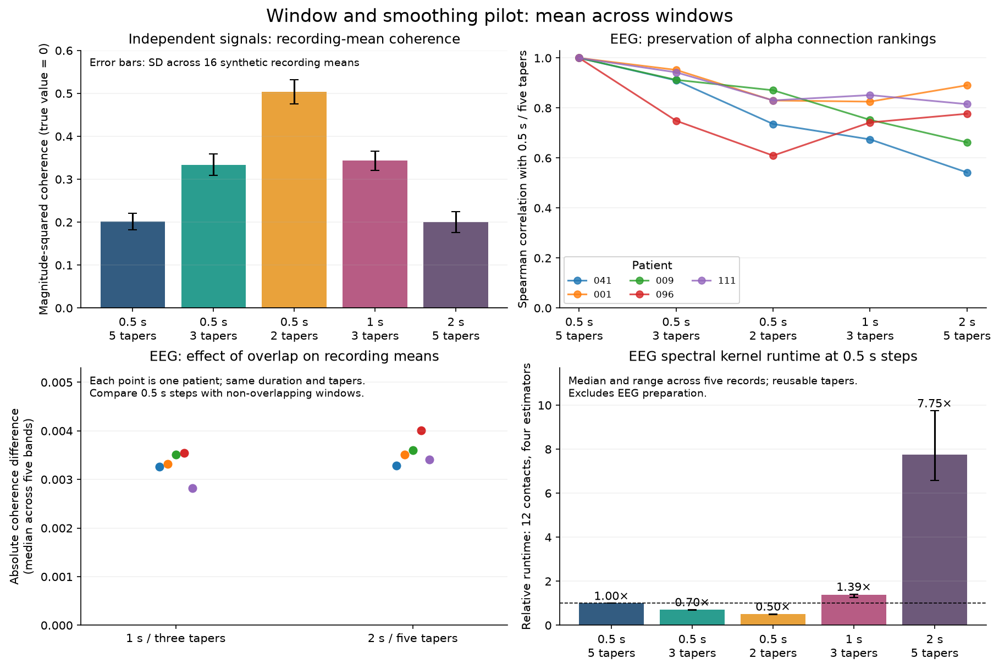

# Window and smoothing pilot

This experiment addresses the user's final aggregation: the mean of each
connectivity value over windows. It does not choose settings by EZ-label
performance, establish clinical usefulness, or change production defaults.

The reproducible probe is
`audit/checks/probes/spectral_window_smoothing.py`; the receipt is
`audit/briefing/spectral_window_smoothing.json`. The companion plotting script
reads the receipt without recalculating connectivity.

## Scope and protocol

- Five settings: 0.5 seconds with NW=3/2/1.5 (5/3/2 tapers), 1 second with
  NW=2 (3 tapers), and 2 seconds with NW=3 (5 tapers). Sampling rate is 2048 Hz.
- Four representative estimators: magnitude-squared coherence (`cohmag`), wPLI,
  debiased squared wPLI, and raw adjacent-bin PSI. Frequency bands are inclusive
  1-4, 4-8, 8-12, 13-30 and 30-70 Hz. The first three use band means. Band
  maxima and factorization-based metrics are outside this focused comparison;
  the latter's numerical policy is still under review.
- Sixteen independent synthetic 20-second recordings, with different noise
  colors, contain independent pairs, a shared 9-11 Hz component with a known
  phase lag, and an intermittently coupled pair with 10% duty cycle. Synthetic
  SDs are across recording means, not across supposedly independent windows.
  The intermittent fixture includes an event at the recording boundary, so
  changes reflect both nonlinear window aggregation and boundary weighting.
- EEG: five full recordings chosen by native rate and contact count, without
  reading EZ labels. Twelve retained contacts are sampled per patient with a
  fixed seed, giving 66 unique connections. This sample is insufficient to
  reproduce an electrode feature that averages connections to *all* contacts.
- EEG preprocessing follows the repository's example, which is not confirmed
  as the user's historical preprocessing: native-rate 60 Hz harmonic notches,
  polyphase resampling to 2048 Hz, 0.5-500 Hz FIR filtering, common-average
  referencing across the full retained-contact pool, then per-window linear
  detrending and z-scoring. Only the contact sample and the full-pool mean are
  retained in memory; identical linear filters/resampling commute with that
  mean. Source recordings and metadata are opened read-only.
- Every complete window is evaluated at 0.5-second steps. Longer non-overlapping
  results are obtained by subsampling these same results, with no repeated
  computation. Different durations can exclude slightly different trailing
  portions. Each patient's recording means and rankings are compared separately.
- Timing uses 32 synthetic channels, the four shared estimators, three alternating
  runs after warmup, one numerical thread and one CPU. Tapers are reused. Timings
  exclude EDF preparation, taper construction, Calculator/report/storage overhead,
  and the rest of retained185; they are not whole-dataset runtime predictions.

## Synthetic recording means

| Duration / tapers | Independent-pair coherence | Independent-pair wPLI | Independent-pair debiased squared wPLI | Coupled alpha coherence | Theta excess above null |
| --- | ---: | ---: | ---: | ---: | ---: |
| 0.5 s / 5 | 0.201 | 0.499 | 0.005 | 0.573 | 0.283 |
| 0.5 s / 3 | 0.334 | 0.635 | 0.028 | 0.704 | 0.170 |
| 0.5 s / 2 | 0.504 | 0.761 | 0.045 | 0.777 | 0.098 |
| 1 s / 3 | 0.343 | 0.632 | 0.013 | 0.740 | 0.052 |
| 2 s / 5 | 0.200 | 0.496 | 0.004 | 0.720 | 0.025 |

The independent pairs have zero population coupling. Their nonzero raw
coherence/wPLI values persist after averaging windows. Fewer tapers reduce
smearing of the narrowband component into theta, but raise the raw estimators'
null means. Debiased squared wPLI stays much closer to zero; its across-recording
SD rises from 0.058 to 0.069 to 0.117 as half-second taper count falls 5 -> 3 -> 2.
These numbers do not imply that bias can simply be subtracted on arbitrary EEG.

The narrowband pair's population coherence is `(16/17)^2` inside 9-11 Hz and
zero outside. Alpha-band means are not that single-bin population value:
they include other bins, and the selected bins differ across durations.

For the intermittent pair, mean beta coherence minus the independent-pair mean
is 0.071 at 0.5 seconds/five tapers and 0.009 at 2 seconds/five tapers.
Thus averaging the final metric over time does not generally undo changing
its input-window length. This is a synthetic sensitivity example, not evidence
that either setting best distinguishes EZ electrodes.

## EEG recording means and ranks

All five recordings completed, with no nonfinite evaluated values. Recordings
041/001/009/096/111 span native sampling rates 512/1024/2048 Hz and retained
contact counts 106/118/71/132/249. Each setting uses the same twelve contacts
within a patient. These are five selected patients, not a representative
prevalence estimate for all 69.

The table summarizes 25 separate patient-band comparisons. Rank correlations
compare the same 66 connections within a patient and band, after averaging
windows. No windows or patients are pooled into one correlation. Timing ratios
are medians of five within-recording ratios, excluding preparation.

| Duration / tapers | EEG kernel time versus current | Median coherence absolute change | Median rank agreement: coherence | wPLI | Debiased squared wPLI | PSI |
| --- | ---: | ---: | ---: | ---: | ---: | ---: |
| 0.5 s / 3 | 0.70x | 0.115 | 0.952 | 0.783 | 0.775 | 0.493 |
| 0.5 s / 2 | 0.50x | 0.269 | 0.848 | 0.531 | 0.432 | 0.253 |
| 1 s / 3, 50% overlap | 1.39x | 0.106 | 0.825 | 0.474 | 0.424 | 0.238 |
| 2 s / 5, 75% overlap | 7.75x | 0.029 | 0.777 | 0.413 | 0.415 | 0.182 |

These are sensitivity results, not agreement with a known EEG ground truth.
For example, coherence rank agreement at 0.5 seconds/three tapers ranges from
0.749 to 0.991 across the patient-band comparisons; wPLI ranges 0.138-0.979.
Some weak, near-zero relationships can change rank without large absolute
changes. Agreement with the current estimator does not prove predictive value,
and a changed ranking does not establish that the candidate is worse.

Within a fixed longer-window setting, overlap has a smaller effect on means:

| Metric | Median absolute change: 1 s overlapping vs non-overlapping | 2 s overlapping vs non-overlapping | Median rank agreement: 1 s | 2 s |
| --- | ---: | ---: | ---: | ---: |
| Coherence | 0.0033 | 0.0035 | 0.952 | 0.964 |
| wPLI | 0.0048 | 0.0063 | 0.835 | 0.851 |
| Debiased squared wPLI | 0.0101 | 0.0091 | 0.829 | 0.853 |
| PSI | 0.0132 | 0.0153 | 0.809 | 0.815 |

Small absolute changes do not imply identical connection rankings or identical
EZ predictions. No improvement from adding overlap has been established here.

## Timing and recommendation

The EEG stage took 635 seconds. Baseline 0.5-second/five-taper computation took
10.2-11.0 seconds per recording for this small twelve-contact workload. Three
tapers took 68-72% of baseline time; two took 48-52%. One-second/three-taper
overlapping estimates took 1.25-1.41x baseline time, and two-second/five-taper
overlapping estimates 6.58-9.75x. These ratios do not predict an all-contact,
all-metric run.

The separate 32-channel synthetic kernel timing was noisier: baseline walls
were 0.135-0.296 seconds, with a 0.185-second median. Median ratios for the other
four settings were 0.91/0.82/2.23/3.85x. Preserve this difference between workloads
instead of presenting one universal speed multiplier. Raw times are retained.

The user accepted leaving the current settings unchanged: common non-overlapping
0.5-second windows and NW=3/five tapers, with the limitations handled in
interpretation. No extra overlap, reduced smoothing, new parameter API or further
parameter/EZ search is required in this refactor. NW=2 remains a possible future
candidate for patient-held-out predictive validation, not a numerically
equivalent optimization. The two-taper setting has much larger null shifts and
ranking changes. This decision preserves the common window definition and avoids
adding cost without demonstrated benefit; it does not establish that the current
low-frequency estimates are well resolved.

## Interpretation limits

This is a small parameter-sensitivity pilot, not a patient-generalization study.
No classifier, label-based parameter search, cross-patient pooling of windows,
or inference treating edges/windows as independent patients is performed.
An eventual EZ usefulness comparison needs the actual edge-to-electrode
aggregation and evaluation on held-out patients. Numerical agreement alone
would not establish clinical or predictive usefulness; disagreement alone does
not show that prediction becomes worse.
